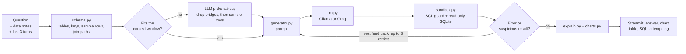

# LLM Data Analyst Agent

Ask a question in plain English about a database or your own CSV / Excel files. The agent
reads the schema, has an LLM write a SQLite `SELECT`, runs it in a read-only sandbox,
fixes its own mistakes (up to 3 retries), and answers with a short explanation, a chart,
the result table and the SQL it ran. Follow-up questions build on earlier ones.
Runs locally on Ollama (qwen3:4b on a 6 GB laptop GPU); Groq is an optional cloud provider.
Plain Python, no agent framework.

<!-- Demo GIF: save the recording as docs/demo.gif and replace the next line with  -->
_Demo GIF coming soon._

**BIRD dev benchmark, 200 questions, shipped defaults, qwen3:4b:**

| | Execution accuracy | Adjusted to BIRD's difficulty mix |
|---|---|---|
| **Without hints** (what real users get) | **38.5%** | **41.0%** |
| With BIRD's evidence hints | 57.0% | 58.0% |

Real users don't get BIRD's hand-written evidence hints ("eligible free rate = free meals /
enrollment"), so the first row is the realistic number. The hints are worth ~16 points,
which is why the app has a **Data notes** box: your own hints, passed to the model the same way.

## Contents

- [How it works](#how-it-works)
- [Results](#results)
- [What helped, what didn't](#what-helped-what-didnt)
- [Known limitations](#known-limitations)
- [Setup](#setup)
- [The app](#the-app)
- [Data](#data)
- [License](#license)

## How it works



"Suspicious" means the query ran but returned 0 rows, only NULLs, a single 0/NULL row
(e.g. `COUNT = 0` from a misspelled filter), or has a known bad shape (a subquery inside a
JOIN's ON, or a ranking value it sorts by but doesn't show). The feedback tells the model
to return the same query if it is sure, and then the result is accepted.

| File | Role |
|---|---|
| `agent/config.py` | All settings, read from `.env` |
| `agent/llm.py` | `chat(messages)` for Ollama and Groq over plain HTTP; latency, tokens/sec, rate-limit waits |
| `agent/schema.py` | Schema as prompt text: columns, types, keys, 3 sample rows, join paths; SQL keywords quoted |
| `agent/generator.py` | System prompt, retry messages, SQL extraction from ```sql blocks |
| `agent/loop.py` | Generate → run → check → retry; fits the prompt to the context window; records every attempt |
| `agent/sqlcheck.py` | SQL shape checks and repair of table aliases that are SQL keywords (`or`, `order`) |
| `agent/fanout.py` | Join fan-out check (off by default, see below) |
| `agent/sandbox.py` | SQL guard + locked-down execution |
| `agent/explain.py` | 1–2 sentence answer from the result |
| `agent/ingest.py` | CSV / Excel → SQLite, snake_case names mapped back to the originals |
| `agent/charts.py` | Rule-based chart choice → Plotly figure |
| `app.py`, `cli.py` | Streamlit chat UI, command line |
| `eval/` | BIRD benchmark runner, scoring, report |

### Sandbox: four layers

The LLM's SQL is untrusted input, so no single check is relied on:
1. **Text guard**: one statement, must start with SELECT/WITH, no write keywords
   (string literals and comments are blanked first so they can't fool it).
2. **`mode=ro` URI**: the file is opened read-only; a wrong path errors instead of creating an empty DB.
3. **`PRAGMA query_only`**: SQLite refuses writes on the connection.
4. **Authorizer callback**: SQLite asks before every operation; only reads are allowed.
   This is the real guarantee (tests run writes with the guard skipped to prove it).

Limits: 10 s per query via a progress handler (`connect(timeout=)` only covers lock waits),
1000 rows via `fetchmany(1001)` so truncation is detected without rewriting the SQL.

## Results

**BIRD dev**: 200 questions (80 simple / 80 moderate / 40 challenging, seed 42), scored with
BIRD's official execution-accuracy rule (same set of result rows). **Adjusted EX** re-weights
the difficulty scores to BIRD dev's real mix (925 / 464 / 145), so it is comparable to
published dev numbers. Temperature 0. Ollama's context is pinned at 4096 tokens in the
benchmark so runs stay comparable; the app and CLI default to 8192 (`OLLAMA_NUM_CTX`),
which the 4B model still fits fully on the GPU (3.3 GB). Full tables, failure reasons and
fixed/broke counts: [eval/results/summary.md](eval/results/summary.md); annotated examples:
[eval/results/failures.md](eval/results/failures.md).

### qwen3:4b vs qwen2.5-coder:7b (EX / adjusted EX, %)

| Run | Adds | qwen2.5-coder:7b | qwen3:4b |
|---|---|---|---|
| `a_names` | table + column names only | 25.5 / 28.8 | 21.0 / 25.1 |
| `b_schema` | + types, keys, sample rows | 34.5 / 38.3 | 36.0 / 38.3 |
| `c_retry` | + self-correction | 35.5 / 39.3 | 40.0 / 42.5 |
| `b_schema+ev` | full schema + evidence hints | 49.5 / 53.0 | 52.5 / 54.8 |
| `c_retry+ev` | + self-correction + evidence | 51.5 / 55.5 | 56.0 / 58.5 |
| **`final`** | **shipped defaults** | – | **38.5 / 41.0** |
| **`final+ev`** | **shipped defaults + evidence** | – | **57.0 / 58.0** |

The smaller model wins: qwen3:4b beats qwen2.5-coder:7b in every run that gets the full
schema, and runs ~1.7× faster (~53 vs ~30 tokens/s) because it fits entirely in 6 GB of
VRAM (the 7B runs 84% GPU / 16% CPU). 5–7 s per question with self-correction.

### Groq model: openai/gpt-oss-120b (50-question check)

The shipped config on Groq's free tier, on the first 50 questions of the same sample
(20 / 20 / 10), next to qwen3:4b on the same 50. Same prompts: the 4096-token budget is
kept, so table selection runs on the same questions. `GROQ_REASONING_EFFORT=low`.

| Model | EX, no hints | EX, with hints | Adjusted, no hints / with | s per question | Tokens per question |
|---|---|---|---|---|---|
| qwen3:4b (local) | 38.0 | 52.0 | 39.4 / 46.8 | 5–6 | – |
| openai/gpt-oss-120b (Groq) | 32.0 | 56.0 | 31.9 / 50.4 | 10–14 | ~1,900 / ~1,300 |

On 50 questions one question is 2 points, and both gaps are within noise: the 120B model
is not clearly better in this pipeline. In 4 of the 7 questions only the 4B got right,
gpt-oss had the right answer plus extra context columns (the school name next to the
count), which BIRD's exact-column rule scores as wrong. Its time per question is mostly
waiting on the free tier's 8,000 tokens/minute limit. Reasoning effort `low` vs Groq's
default gave the same accuracy and token use in a 5-question pilot, and was much faster.

### Phase 1: Chinook, 10 questions

10/10 for both models, 0 retries (counts, filters, 1–3 joins, top-N by revenue). Chinook
is easy for these models; BIRD is the real test. Run it with `python eval_chinook.py`.

## What helped, what didn't

Measured question by question on the same 200 questions (qwen3:4b, fixed / broke):

| Change | Fixed / broke | Net EX | Verdict |
|---|---|---|---|
| Evidence hints | 39 / 7 | **+16** | Biggest lever: many questions hinge on definitions no schema shows. Hence Data notes. |
| Schema context (types, keys, sample rows) | – | **+15** (7B: +9) | Shows real values and formats to match filters against. |
| Self-correction (≤3 retries) | 8 / 0 | **+4** (7B: +1) | Never broke a correct answer. The 4B cleared every `no such column` error; the 7B resent the same failing SQL in 7 of 42 retried questions. |
| `SUSPECT_ZERO_AGG=1` (single 0/NULL row is suspicious) | 2 / 0 | +1 | On. `COUNT = 0` from a misspelled filter used to pass silently. |
| `STRICT_RETRY` (stricter retry prompt) | 0 / 1 | −0.5 | **Off, tested, no gain.** The model read "return the same SQL if sure" as permission to keep a wrong value. |
| `CHECK_FANOUT` (join fan-out rule + self-check) | 6 / 9, with hints 6 / 10 | −1.5 / −2 | **Off: breaks more than it fixes.** The self-check fired on 6 questions and was behind at most 1 change; the prompt rule ("count entities with COUNT(DISTINCT key)") changed first queries, and BIRD's gold SQL usually counts plain rows. |
| `CHECK_SQL_SHAPE` (subquery in JOIN ON, hidden ranking value) | 0 / 2, with hints 1 / 2 (the 1 was run noise) | −1 / −0.5 | **On by design, a small loss on BIRD.** It fired on 4 questions; both losses were the model adding the value it ranked by as a column (q668: the user *and* their 456 badges), which BIRD's exact-column rule counts as wrong. For a person reading the answer that column is the point, and the subquery half fixed a real Olist bug. |
| Join paths + keyword quoting (Phase 3 schema) | 8 / 13, with hints 15 / 13 | −2.5 / +1 | About neutral on BIRD. They make prompts longer, so at 4096 tokens table selection ran on 39.5% of questions instead of 22%. Built for Olist, together with its built-in notes, which took a reviews-by-category question from 0/4 to 4/4. |
| Groq gpt-oss-120b instead of the local 4B | see above | −6 / +4 | Within noise on 50 questions. |

Run `python -m eval.bird --models qwen3:4b-instruct-2507-q4_K_M --runs final final+ev`
to reproduce the headline (about 15 min per run on an RTX 4050 laptop).

## Known limitations

- **Benchmark noise.** Temperature 0 is not fully deterministic on Ollama: identical
  prompts gave different SQL on up to 4 of 200 questions between runs (q962 passed in one
  run, failed in the other with the same prompt), so ±1 point differences mean nothing.
  BIRD's gold answers have errors too: q389 asks for card *names*, the gold SQL returns
  card *ids*, and the agent's correct answer fails in every config. The 50-question Groq
  check has a standard error of about ±7 points.
- **About 4 in 10 hard questions without hints.** On realistic multi-table questions the
  4B picks a wrong column or table often enough that every answer needs checking; the SQL
  and attempt log are always shown for that reason. Data notes help most.
- **A model can confirm its own mistake.** A warning says "return the same query if you
  are sure", and the model sometimes is, wrongly. On Olist, the built-in join-path note
  makes the 4B join `order_items` even for one-table questions ("average review score",
  "payment total per type"), which repeats each review / payment once per item. The
  fan-out check flags the join, and the model resends it. None of the example questions
  hit this. Adding "Join only the tables the question needs" to the notes made it worse
  (two example questions dropped from 3/3 to 0/3 by joining `order_reviews`), so it isn't shipped.
- **Context.** At 4096 tokens, very wide schemas fall back to table selection and then to
  dropping sample rows; if even that doesn't fit, the agent says so instead of answering.
- **Groq free tier.** 8,000 tokens/minute is ~4 questions/minute; the agent waits out
  short limits, and shows an error when a daily limit is hit.
- **Scope.** SQLite only, read-only, uploads up to 50 MB, no login: meant for local use.

## Setup

### Local, with Ollama

```bash
py -3.11 -m venv .venv
.venv\Scripts\activate              # Windows (source .venv/bin/activate elsewhere)
pip install -r requirements.txt
copy .env.example .env               # then edit if needed
python data/download_chinook.py
python data/download_olist.py        # optional, see "Data"
ollama pull qwen3:4b-instruct-2507-q4_K_M

streamlit run app.py                 # http://localhost:8501
python cli.py "Which 5 customers spent the most in total?"
pytest                               # unit tests, no LLM needed
```

Benchmark: `python data/download_bird.py` (346 MB download, ~1.5 GB on disk), then
`python -m eval.bird` (resumable; `--limit 10` for a pilot; `--provider groq --models
openai/gpt-oss-120b --first 50` for the Groq check) and `python -m eval.report`.

### Docker, with Groq

```bash
copy .env.example .env               # set GROQ_API_KEY (free at console.groq.com)
docker compose up --build            # http://localhost:8501
```

- The key is read from `.env` when the container starts; `.env` is never copied into the image.
- Chinook is built into the image. Olist is mounted read-only from `./data` (build
  `data/olist.sqlite` with the local steps above), so the 173 MB database stays out of the image.
- **Ollama instead of Groq:** set `DOCKER_LLM_PROVIDER=ollama` in `.env`. The container
  reaches Ollama on your machine at `host.docker.internal:11434`; on Linux, start Ollama
  with `OLLAMA_HOST=0.0.0.0` so it accepts connections from the container.
- The app is published on `127.0.0.1` only (`APP_PORT` changes the port). Inside the
  container Streamlit listens on `0.0.0.0` so Docker can reach it; local runs without
  Docker stay on `localhost` (`.streamlit/config.toml`).
- The image is multi-arch (`python:3.11-slim`); `docker buildx build --platform linux/arm64 .` builds it for ARM.
- On Windows, run Compose from PowerShell or cmd: Git Bash's lowercase `c:/` path makes
  Compose's builder ask for extra file permissions.

### Settings (`.env`)

| Setting | Default | |
|---|---|---|
| `LLM_PROVIDER` | `ollama` | or `groq` |
| `OLLAMA_MODEL` | `qwen3:4b-instruct-2507-q4_K_M` | `qwen2.5-coder:7b` also tested |
| `OLLAMA_NUM_CTX` | `8192` | context window; the benchmark pins 4096 |
| `GROQ_MODEL` / `GROQ_REASONING_EFFORT` | `openai/gpt-oss-120b` / `low` | |
| `SUSPECT_ZERO_AGG`, `CHECK_SQL_SHAPE` | `1` | see "What helped" |
| `STRICT_RETRY`, `CHECK_FANOUT` | `0` | tested, off |

## The app

- **Data:** Chinook (music store), Olist (Brazilian e-commerce), or upload CSV / Excel
  files. Each file or sheet becomes a table in a temporary SQLite file; names are cleaned
  to snake_case for the SQL (`Order Date` → `order_date`), and results and charts show your
  original column names.
- **Example questions:** 5 per demo database, each passed 3 runs out of 3 at the app defaults.
- **Answer:** a 1–2 sentence explanation, a chart picked by rules (single number → metric
  card, dates → line, label + number → bar, two numbers → scatter, one number column →
  histogram), the table, the SQL, and the log of every attempt.
- **Data notes:** your hints ("revenue = price + freight_value") are added to every
  question like BIRD's evidence hints. Olist comes with built-in notes (join paths,
  "count orders with COUNT(DISTINCT order_id)", prices in BRL).
- **Follow-ups:** the last 3 questions and their SQL go into the prompt, so "now only
  2017" edits the previous query. If that overflows the context window, older turns are
  dropped first.
- Listens on `localhost` only, uploads capped at 50 MB (`.streamlit/config.toml`).

## Data

- **Chinook** sample database by Luis Rocha,
  [lerocha/chinook-database](https://github.com/lerocha/chinook-database) (MIT).
- **Olist**: [Brazilian E-Commerce Public Dataset by Olist](https://www.kaggle.com/datasets/olistbr/brazilian-ecommerce),
  ~100k orders from 2016–2018, licensed
  [CC BY-NC-SA 4.0](https://creativecommons.org/licenses/by-nc-sa/4.0/): non-commercial
  use only, with attribution, and derived data shared under the same license. This
  project uses it only as a non-commercial demo. Kaggle needs a login, so download it by
  hand and run `python data/download_olist.py path/to/archive.zip` (a zip or an extracted
  folder). The raw files and the built `data/olist.sqlite` are not committed.
- **BIRD** dev set: [bird-bench.github.io](https://bird-bench.github.io), licensed
  [CC BY-SA 4.0](https://creativecommons.org/licenses/by-sa/4.0/). Downloaded by
  `data/download_bird.py` and not committed; the files in `eval/results/` that contain
  BIRD questions, SQL or results are derived from it and shared under the same license
  ([eval/results/LICENSE](eval/results/LICENSE)). Citation: Jinyang Li, Binyuan Hui,
  Ge Qu, et al., "Can LLM Already Serve as A Database Interface? A BIg Bench for
  Large-Scale Database Grounded Text-to-SQLs", NeurIPS 2023 Datasets and Benchmarks
  Track, [arXiv:2305.03111](https://arxiv.org/abs/2305.03111).

## License

Code: [MIT](LICENSE). The datasets keep their own licenses (see "Data"): BIRD-derived
files in `eval/results/` are CC BY-SA 4.0 ([eval/results/LICENSE](eval/results/LICENSE)),
and Olist is CC BY-NC-SA 4.0 (not included in this repository).
